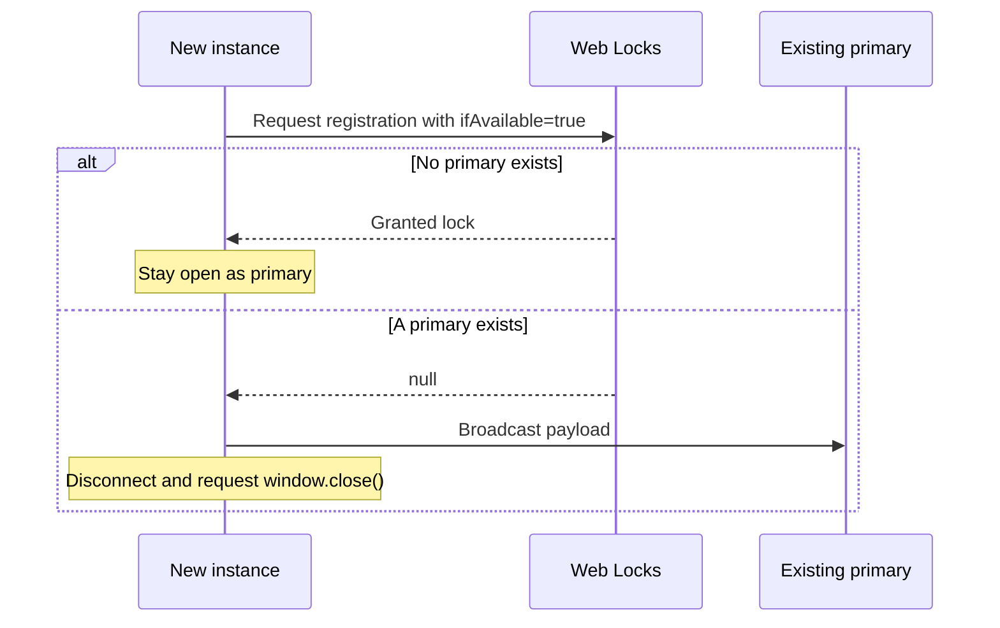

# central-tasklist

Use the [root instructions](../README.md#start) to start the applications.

## Communication walkthrough

All communication is in [tab-communication.ts](src/communication/tab-communication.ts). The module has no application imports or DOM dependencies.

1. Open a BroadcastChannel for the group.
2. Request the group lock with `ifAvailable: true`.
3. If the browser grants the lock, stay open as primary.
4. If another tab holds the lock, send the newly opened tab’s relative URL through BroadcastChannel.

Only the primary processes incoming messages. The primary keeps the lock callback promise pending. `close()` resolves that promise and closes the channel.



The only message format is:

```ts
{ type: 'message', value: '/?key=main-tab-demo&message=Hello#details' }
```

## Code structure

| File                                                           | Function                                                               |
| -------------------------------------------------------------- | ---------------------------------------------------------------------- |
| [tab-communication.ts](src/communication/tab-communication.ts) | Register the tab, validate data, send messages, and release resources. |
| [startup-handoff.ts](src/startup-handoff.ts)                   | Keep the primary open. Send once and close a secondary.                |
| [app.ts](src/app.ts)                                           | Read URL parameters and control the interface.                         |

Use the communication module separately:

```ts
import { TabCommunication } from './src/communication/tab-communication.ts';

const tabs = new TabCommunication('main-tab-demo');
tabs.subscribe({
  onChange: () => {
    if (tabs.state === 'secondary')
      tabs.send('/?key=main-tab-demo&message=Hello#details');
  },
  onMessage: ({ value }) => console.log(value),
  onError: (error) => console.error(error),
});
```

Call `tabs.close()` when the application stops. Tests can supply `locks` and `createChannel` substitutes.

## URL parameters

| Parameter | Default         |
| --------- | --------------- |
| `key`     | `main-tab-demo` |

The transferred value contains the opened URL's path, query string, and fragment, without its origin. The `message` parameter is ordinary URL data; it no longer replaces the transferred value.

The primary shows its own initial relative URL in **Opened URLs**, using the same appearance as transferred URLs. URLs are captured before the app adds a default `key` parameter to the address bar. New arrivals appear first and contribute to the count; the initial URL does not trigger focus or unread notifications.

Each transferred URL also becomes the primary tab's current address through `history.pushState()`. This adds a browser history entry without reloading the page, preserving the opened URL list and the active connection. Back and Forward move between these addresses while retaining the list.

## Limits

- Tabs must share the same origin, browser storage partition, and group key.
- Sending has no receipt confirmation or automatic retry. A message can be lost if the primary closes.
- Registration or send errors keep the tab open.
- The browser can prevent focus changes or tab closure. Close the secondary manually if necessary.
- The list holds up to 100 URLs in memory. The application does not use sessionStorage or localStorage.
