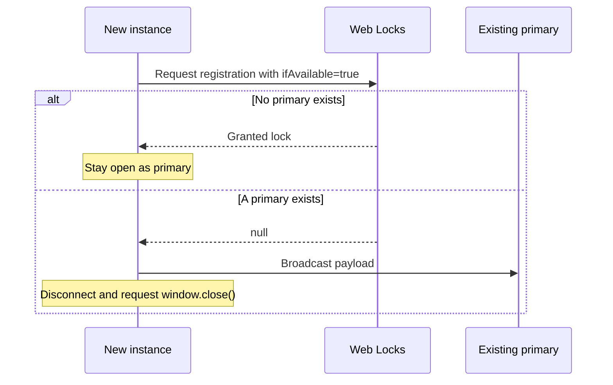

# Central Single Tab Application

The first instance registers as primary. Each later instance checks whether the group already has a primary, sends it the URL's `message` value, and requests to close itself.

Install dependencies from the repository root with `npm install`. Requires Node.js 22.18 or newer. Start the central app with `npm start`, then open http://localhost:3000. Start Integrated Satellite System in a second terminal with `npm run start:launcher`, then open http://localhost:3001 and submit a message.

The group comes from the `key` query parameter, defaulting to `main-tab-demo`. The default message is `Another instance of Central Single Tab Application was opened.` The primary does not send its own startup message.

## Communication walkthrough

There are two operations:

1. Make one non-waiting Web Locks request with `ifAvailable: true`. A granted lock registers this instance as primary; a `null` lock means another primary already exists.
2. If another primary exists, publish the payload through BroadcastChannel. Only the primary processes incoming payloads.

The complete wire format is:

```ts
{ type: 'message', value: 'Text from the satellite' }
```

There are no discovery messages, acknowledgements, heartbeats, peer lists, departure messages, message IDs, retries, or takeover queues.

### Code structure

| File                                                                           | Responsibility                                                                                         |
| ------------------------------------------------------------------------------ | ------------------------------------------------------------------------------------------------------ |
| [`src/communication/protocol.ts`](src/communication/protocol.ts)               | Defines and validates the single payload message.                                                      |
| [`src/communication/ports.ts`](src/communication/ports.ts)                     | Defines transport and registration interfaces.                                                         |
| [`src/communication/browser-runtime.ts`](src/communication/browser-runtime.ts) | Implements those interfaces with BroadcastChannel and Web Locks.                                       |
| [`src/main-tab.ts`](src/main-tab.ts)                                           | Checks registration once, sends secondary payloads, and passes incoming payloads to primary observers. |
| [`src/startup-handoff.ts`](src/startup-handoff.ts)                             | Keeps the primary open; sends once and closes a secondary.                                             |
| [`src/app.ts`](src/app.ts)                                                     | Connects these pieces to the DOM, tab title, focus request, and window-close request.                  |

```ts
const runtime = createBrowserTabRuntime(groupKey);
const connection = new MainTabConnection(runtime);

connection.subscribe({
  onChange: render,
  onMessage: receiveMessage,
  onError: showRegistrationError,
});
```

The browser adapter holds the granted lock by keeping its callback's promise pending. Closing the primary resolves that promise; the browser also releases registration when the tab exits. A secondary never queues for ownership. After the primary closes, a newly opened instance can register as primary.

### Startup sequence



Only the payload arrow is an inter-tab message. The registration result comes directly from the browser API; it does not require asking the other tab to reply. BroadcastChannel broadcasts to the group, so this is not a privacy boundary between group members.

## Behavior and limits

- The sender closes after `postMessage()` succeeds. There is no receipt confirmation. If the primary disappears between registration checking and sending, the payload may be lost.
- Registration or send failures keep the window open and show an error. There are no automatic retries.
- Browsers can refuse `window.close()`. The disconnected instance then shows a manual-close notice. [Window.close() documentation](https://developer.mozilla.org/en-US/docs/Web/API/Window/close)
- The primary requests focus on incoming data, and tracks unread messages in its title if it remains unfocused. Focus remains browser-controlled.
- The inbox keeps up to 100 messages in memory. No sessionStorage or localStorage data is used or copied.
- Tabs must share an origin, browser storage partition, and group key. Use HTTPS or localhost with Web Locks and BroadcastChannel support.

## Development

Edit TypeScript in `src/` and static assets in `public/`. `npm run build` compiles the browser modules and copies assets to generated `dist/`. Restart after edits to rebuild. The UI uses published `@holisticon/hap-foundation` 2.0.0 and shared layout styles in `../styles/hap-app.css`.

Source imports use `.ts` for Node's built-in TypeScript support. The TypeScript build rewrites them to `.js` for the browser. Run `npm run check` for strict type checking and `npm test` for tests. Formatting commands are available from the repository root.

- `tests/coordinator.test.ts` covers registration, one-way sending, closing, failures, and cleanup with a manually driven runtime.
- `tests/protocol.test.ts` rejects malformed payloads and the removed protocol messages.
- `tests/browser-communication.test.ts` exercises the real BroadcastChannel adapter, verifies that only payloads are exchanged, and checks native Web Locks when available.
