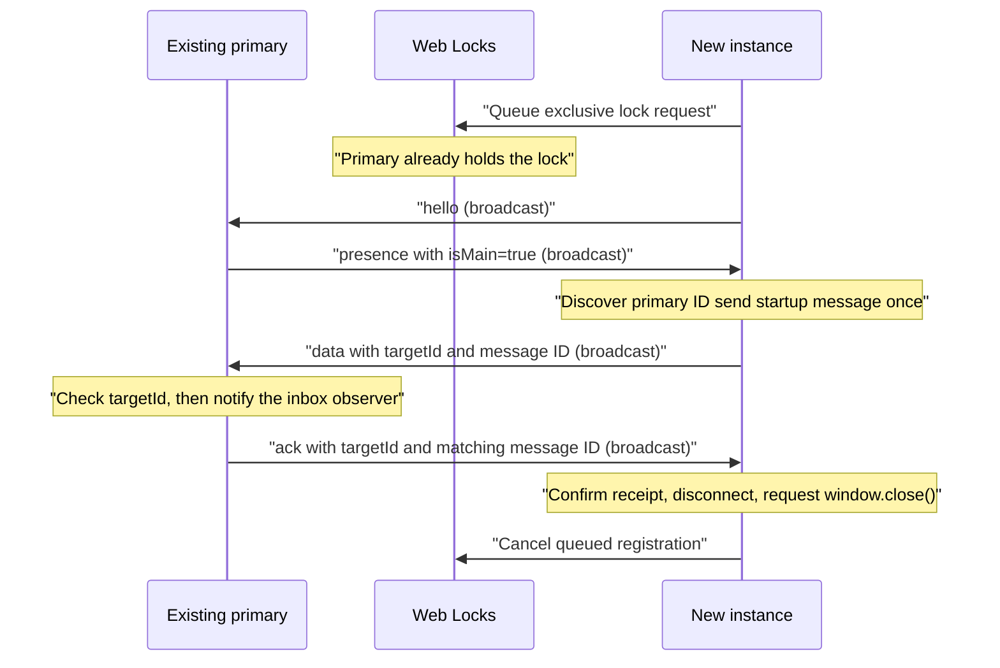

# Central Single Tab Application

A TypeScript browser app with no runtime package dependencies that keeps one primary tab per group. New instances automatically send their startup message to the primary and close after receipt confirmation.

Install dependencies with `npm install` from the repository root. Requires Node.js 22.18 or newer. Run `npm start` in this directory to build and serve the app with the `http-server` npm module, then open http://localhost:3000. The first tab displays the primary inbox. Open the same URL in another tab or submit a message from Integrated Satellite System to test startup handoff: the new instance sends a message and closes after acknowledgement. The group key comes from the URL's `key` parameter and defaults to `main-tab-demo`.

Edit TypeScript in `src/` and static assets in `public/`. `npm run build` generates browser JavaScript and copies assets into `dist/`. Restart after edits to rebuild; `dist/` is generated output and should not be edited directly. Tests and the asset-copy script use Node's built-in TypeScript support.

The UI declares published npm package `@holisticon/hap-foundation` 2.0.0 for components and CSS tokens. `public/styles.css` imports the shared `hap-app.css`, which imports the foundation stylesheet resolved from the npm installation. The build preserves the package's internal CSS import paths. Shared layout styles live in `../styles/hap-app.css`.

The browser adapter holds an exclusive Web Lock named for the group. The first request gets the lock; later requests wait in order. Closing the connection aborts a queued request or releases a held lock. The browser also releases locks when a tab is destroyed. Heartbeats update the visible tab list; Web Locks control ownership, so a delayed heartbeat cannot elect a second main tab.

New tabs discover the primary through BroadcastChannel announcements. `send(value)` sends a message addressed to its ID, and only that tab processes it and returns an acknowledgement. BroadcastChannel is a group transport, so this routing is not an access boundary between group members.

`handoffOnStartup()` in `src/startup-handoff.ts` waits for the registration result. If this instance becomes primary, it stays open. Otherwise it sends exactly one startup message and waits for the matching acknowledgement. Confirmed delivery closes its connection, cancels its queued lock request, and calls `window.close()`. If the primary disappears and this instance takes over before acknowledgement, it remains open as primary.

The default message is `Another instance of Central Single Tab Application was opened.` An optional `message` query parameter supplies custom text. No message is automatically sent by the first primary.

If discovery or acknowledgement times out after five seconds, the instance stays open and reports that delivery could not be confirmed. Reload to try again. A late acknowledgement after timeout does not close it. Messages are not automatically retried or replayed after a primary change.

Browsers can refuse `window.close()` for tabs opened through browser controls. After successful delivery, the page shows that the user can close it manually if it remains open. The instance has already disconnected, so it cannot later take over as primary. [Window.close() documentation](https://developer.mozilla.org/en-US/docs/Web/API/Window/close)

The primary inbox keeps up to 100 received messages in memory. Reloading or changing groups clears it. A returning tab registers again and runs the startup check. The app never reads or writes sessionStorage or localStorage. It does not copy past messages or storage data between tabs.

Tab titles show `Primary` or `Secondary` and update automatically when a tab takes over as main. The main tab requests focus when it receives a message. Browsers may ignore the request. Messages received while the tab is hidden or unfocused add an unread count to its title. Returning focus to the visible tab clears the count, as does leaving the group.

Browsers must support Web Locks and BroadcastChannel; use HTTPS or localhost. Tabs must use the same origin, browser storage partition, and group key. If a main tab is suspended, it retains its lock until the browser releases it; messages wait for that tab to run again rather than causing a second main tab to be elected.

Run `npm run check` for strict type checks and `npm test` for registration and messaging tests. Formatting commands are available from the repository root; see the [root README](../README.md).

## Communication walkthrough

Read the implementation in this order:

| File                                                                           | Responsibility                                                                                                                  |
| ------------------------------------------------------------------------------ | ------------------------------------------------------------------------------------------------------------------------------- |
| [`src/communication/protocol.ts`](src/communication/protocol.ts)               | Defines the plain-data messages sent between tabs and validates incoming data.                                                  |
| [`src/communication/ports.ts`](src/communication/ports.ts)                     | Defines the transport, primary election, clock, and ID capabilities the coordinator needs.                                      |
| [`src/communication/browser-runtime.ts`](src/communication/browser-runtime.ts) | Implements those capabilities using BroadcastChannel, Web Locks, AbortController, crypto, and timers.                           |
| [`src/main-tab.ts`](src/main-tab.ts)                                           | Coordinates discovery, primary identity, targeted delivery, acknowledgements, and peer presence. It does not call browser APIs. |
| [`src/startup-handoff.ts`](src/startup-handoff.ts)                             | Decides whether to stay open as primary or send one message and close after its receipt.                                        |
| [`src/app.ts`](src/app.ts)                                                     | Wires the browser adapter to the coordinator and renders the DOM. Focus and window-close requests stay here.                    |

The composition in `app.ts` is explicit:

```ts
const runtime = createBrowserTabRuntime(groupKey);
const connection = new MainTabConnection(runtime);

const unsubscribe = connection.subscribe({
  onChange: render,
  onMessage: receiveMessage,
  onError: showRegistrationError,
});
```

`subscribe()` returns a function that removes the observer. Callbacks receive typed values directly. These callbacks run within the current page; they are not inter-tab messages. `close()` removes observers, stops the heartbeat, closes the channel, and leaves the primary election. No EventTarget or CustomEvent casts are needed in application code.

### Two independent browser mechanisms

**Web Locks determines ownership.** The adapter queues an exclusive lock request for `main-tab:<groupKey>`. Its callback runs only once ownership is granted. Keeping the callback's promise pending holds ownership; resolving it releases ownership. AbortController cancels a request that is still waiting. `WebLocksPrimaryElection.join()` hides those mechanics behind an elected callback and a cleanup function.

**BroadcastChannel carries data.** Every group member receives broadcasts from the other members. The coordinator filters `targetId` before processing data or acknowledgements. A broadcast does not elect a primary, and a missing heartbeat does not release its lock. The adapter validates unknown incoming values before delivering typed protocol messages to the coordinator.

### Startup and delivery sequence



If there is no primary, Web Locks grants the first request. The coordinator announces `main` and the startup controller keeps that instance open. If the current primary disappears while another instance is still waiting, Web Locks grants the next request; that instance becomes primary instead of closing.

### Protocol reference

| Message    | Sent when                                            | Receiver action                                                                                    |
| ---------- | ---------------------------------------------------- | -------------------------------------------------------------------------------------------------- |
| `hello`    | An instance starts.                                  | Record the peer and reply with presence.                                                           |
| `presence` | Replying to hello or sending the periodic heartbeat. | Update the peer list and remember an announced primary.                                            |
| `main`     | Exclusive ownership is granted.                      | Remember the primary ID.                                                                           |
| `data`     | A secondary sends its payload.                       | Only the addressed primary processes it and sends a receipt.                                       |
| `ack`      | The primary has processed the data.                  | The addressed secondary receives a typed delivery callback; startup checks its pending message ID. |
| `bye`      | A connection closes.                                 | Remove the peer and clear its primary identity if applicable.                                      |

### Testing the boundaries

- `tests/coordinator.test.ts` uses a manually driven `TestRuntime`. It exercises routing, election, receipts, cleanup, and timeouts in peer presence without browser APIs or real timers.
- `tests/protocol.test.ts` checks wire-format validation and rejects malformed messages.
- `tests/browser-communication.test.ts` runs the real BroadcastChannel adapter and startup flow. A FIFO lock substitute supports Node 22; native Web Locks are also exercised when available.

Source imports use `.ts` so Node can run tests directly. The TypeScript build rewrites those relative imports to `.js` for the browser. Replacing the browser adapter in a test does not require changing the protocol, coordinator, startup controller, or UI behavior.
